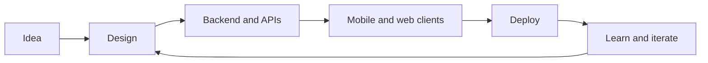

# Building Mobile and Web Products: The Skills That Matter in Practice

*Last updated: November 3, 2026*

Building mobile and web products takes more than writing code. You decide what to build, pick the right approach for each platform, and own the work from architecture to deployment. This guide covers the software engineering skills and decisions that matter most when you ship both, with practical steps and trade-offs.

**Key takeaways**

- Building mobile and web products is a product skill as much as a coding skill.
- Mobile-first thinking improves both the app and the website.
- Cross-platform frameworks save effort but come with trade-offs.
- Owning work end to end, from architecture to deployment, builds the strongest engineers.
- Backend, frontend and infrastructure skills work best together.

## What does building mobile and web products involve?

Building mobile and web products means designing, coding, deploying and maintaining software that people use on phones and in browsers. It covers frontend, backend, data and infrastructure. Often one engineer or a small team has to connect all of these layers, and that is where the deepest learning happens.

Coding is only one part of the job. One guide puts it well: web and mobile development is about creating experiences that connect a business with its users, not just writing code [[1]](https://devspheretechnologies.com/web-and-mobile-application-development). The code serves the product. If the product does not solve a real problem, clean code will not save it.

This guide comes from Lakshay Goyal, a Software Engineer building thoughtful mobile and web products. You can read more about his background on the [about page](/about). Here, the focus is on the skills and decisions behind shipping work on both platforms.

### The layers of a product

Every product has a few layers that must agree with each other. A mistake in one layer shows up in another, so it helps to know the whole stack, even if you specialise.

- The client layer: mobile apps and web interfaces that users touch
- The API layer: the contract between clients and servers
- The data layer: databases, storage and the rules around them
- The infrastructure layer: servers, deployments and monitoring
- The product layer: the problem, the users and the order of priorities

### Why both platforms matter

Users do not think in platforms. They want the thing to work wherever they are. A person may discover a product in a browser, then install the app, then return on the web. Treating both as one product, with shared logic and consistent behaviour, is far less painful than treating them as two projects.

That mindset shapes every later decision: how you design the API, what you share between clients, and how you test. The next sections walk through those decisions in the order they usually come up.

## Why mobile-first thinking shapes both platforms

Mobile-first thinking means designing for the smallest screen first, then expanding to larger ones. It matters because a large share of visits happen on phones. One source reports that about 60.5% of all web traffic came from mobile devices as of 2025 [[2]](https://www.weweb.io/blog/how-to-build-a-mobile-responsive-web-app).

Starting from desktop often hurts the phone experience. Cramming a feature-rich desktop design onto a small screen tends to feel cluttered or broken [[2]](https://www.weweb.io/blog/how-to-build-a-mobile-responsive-web-app). Starting small forces you to decide what really matters, and that discipline improves the large-screen version too.

Search engines care as well. Google began mobile-first indexing in 2018, which means it mainly uses the mobile version of a site for indexing and ranking [[2]](https://www.weweb.io/blog/how-to-build-a-mobile-responsive-web-app). A weak mobile page can therefore hurt discoverability, not only usability.

### A practical mobile-first checklist

- Set the viewport correctly so the page width matches the device width [[2]](https://www.weweb.io/blog/how-to-build-a-mobile-responsive-web-app)
- Design the core user flow for the smallest screen first
- Add layout changes at larger breakpoints instead of removing content
- Keep touch targets large and navigation simple
- Test on real devices, not only in a desktop browser
- Check loading speed on slower connections

Without the viewport tag, mobile browsers often show a tiny, zoomed-out version of the desktop site, and a responsive design will not work [[2]](https://www.weweb.io/blog/how-to-build-a-mobile-responsive-web-app). It is a small line that breaks everything when missing.

### What it means for apps

Mobile-first is not only for websites. In a native or cross-platform app, it means you plan for limited screen space, interrupted sessions and unreliable networks from day one. Those constraints make the web version more resilient as well.

*A mobile view from selected work, designed with the small screen in mind.*

*The matching web view, which expands the same core flow.*

Responsive work pays off in business terms too. One source cites about an 11% higher conversion rate for responsive layouts [[2]](https://www.weweb.io/blog/how-to-build-a-mobile-responsive-web-app). Another notes that up to 73% of visitors may leave a site that is not mobile friendly [[2]](https://www.weweb.io/blog/how-to-build-a-mobile-responsive-web-app).

## How do native, cross-platform and web approaches compare?

The right approach depends on the product, the team and the timeline. Native gives deep platform access, cross-platform shares one codebase, and web reaches everyone through a browser. Each option trades speed, performance and maintenance effort against the others, so there is no single best answer.

*Comparison of common approaches for mobile and web products*

| Approach | Strength | Trade-off |
| --- | --- | --- |
| Native | Deep platform features, with a growing focus on security and compliance [[3]](https://blog.intimetec.com/a-guide-to-mobile-and-web-app-development) | Separate codebases for each platform |
| Cross-platform | One codebase across platforms, using frameworks such as Flutter and React Native [[3]](https://blog.intimetec.com/a-guide-to-mobile-and-web-app-development) | React Native needs native code for advanced features [[4]](https://www.intelivita.com/blog/mobile-web-development/) |
| Web app | Works across devices and updates instantly [[3]](https://blog.intimetec.com/a-guide-to-mobile-and-web-app-development) | Limited access to some device features |
| Progressive web app | Avoids the friction of app store approval [[3]](https://blog.intimetec.com/a-guide-to-mobile-and-web-app-development) | Depends on browser support |

### Choosing a cross-platform framework

Cross-platform tools differ in what they ask of you. React Native lets you build with JavaScript and React, and it is easy for React developers to pick up [[4]](https://www.intelivita.com/blog/mobile-web-development/). Flutter uses the Dart language and is fast, but the learning curve is steeper [[4]](https://www.intelivita.com/blog/mobile-web-development/).

Ionic builds on HTML, CSS and JavaScript, so it is easy for web developers to learn. The cost is that it does not match native performance in complex apps [[4]](https://www.intelivita.com/blog/mobile-web-development/). Match the tool to the skills your team already has.

### When native is worth it

Go native when the product depends on platform features, tight performance or strict security needs. Native work now carries more attention on data protection, secure authentication and performance as part of the lifecycle [[3]](https://blog.intimetec.com/a-guide-to-mobile-and-web-app-development). If none of that applies, a shared codebase usually wins on speed.

### When the web is enough

A web app is often the fastest way to test an idea. It needs no store review, it updates for everyone at once, and it is easier to maintain than traditional installed software [[3]](https://blog.intimetec.com/a-guide-to-mobile-and-web-app-development). Many teams start there and add an app once the core flow proves itself.

> Pick the approach that fits the product and the team, not the one that is trending this year.

## Which software engineering skills matter most?

The most useful software engineering skills are the ones that connect layers: frontend, backend and infrastructure. Engineers who can move between them ship faster and debug better, because they understand where a problem actually begins instead of guessing from the symptom.

### Frontend skills

Frontend work still rests on HTML, CSS and JavaScript, with modern frameworks such as React, Angular and Vue on top [[3]](https://blog.intimetec.com/a-guide-to-mobile-and-web-app-development). Frameworks change often. The lasting skills are layout, accessibility, state management and a feel for how an interface behaves on slow devices.

### Backend and API skills

Backend development handles server logic, data processing and database work. Current practice leans toward serverless designs, microservices and API-first development, which make applications easier to scale and maintain [[3]](https://blog.intimetec.com/a-guide-to-mobile-and-web-app-development). Clients and servers then talk through REST, GraphQL or WebSockets [[3]](https://blog.intimetec.com/a-guide-to-mobile-and-web-app-development).

For product work, the API is a promise. Design it so both a mobile app and a web client can use it without special cases. Clear naming, stable responses and good error messages save many hours later.

### Infrastructure and deployment skills

Servers, deployments and monitoring decide whether a product stays up. Knowing how to ship, roll back and watch a system turns a prototype into something people can rely on. This layer is easy to ignore until the first outage.

### Product and communication skills

Technical range is not enough. Strong engineers ask what problem a feature solves, push back on scope that adds little, and explain trade-offs in plain language. These habits matter to hiring managers as much as framework knowledge.

- Frontend: layout, state, accessibility and performance
- Backend: data modelling, APIs and reliability
- Infrastructure: deployment, monitoring and recovery
- Product sense: scoping, prioritising and testing assumptions
- Communication: writing clearly and explaining trade-offs

## How does a product move from idea to launch?

A product moves from idea to launch through a repeatable flow: define the problem, design the experience, build the backend and clients, deploy, then learn from real use. Skipping a step usually costs more later, because mistakes found after launch are the hardest to fix.

*A simple delivery loop for a mobile and web product.* <!-- alt: Flowchart of a product moving from idea through design, build and deployment back to iteration -->

### Step by step

1. Define who the product is for and the one job it must do well
2. Sketch the core flow on the smallest screen first
3. Model the data and design the API around that flow
4. Build the mobile and web clients against the same API
5. Set up deployment, logging and basic monitoring
6. Release to a small group and collect feedback
7. Fix what hurts most, then widen the release

### Keep the first version small

The first release should prove one idea, not ten. A narrow scope lets you finish, learn and adjust. Extra features can wait until real users show you what they actually need.

### Plan for change

Requirements will move. Keep modules small, keep the API versioned or at least backward compatible, and avoid decisions that are costly to reverse. Flexible design is cheaper than a rewrite.

For more notes from building, deploying and learning software, browse the [blog](/blog).

## What does owning a product end to end teach you?

Owning a product end to end teaches trade-offs that narrow roles tend to hide. As a Founding Engineer in Bangalore, Lakshay built a food delivery platform from scratch, handling architecture, mobile apps, servers and deployments, along with the chaos in between.

Working across the whole stack forces you to feel the cost of every decision. A rushed API choice hurts the app. A slow query hurts the screen. A missing deployment step hurts everyone. You stop seeing layers as separate.

### What changes in your thinking

- You design APIs with the client developer in mind, because you are that developer
- You treat deployment as part of the feature, not an afterthought
- You notice performance problems earlier
- You cut scope sooner, since you carry the maintenance cost
- You learn to debug across the whole system

### Working across the stack today

Today he works as a Software Engineer on tools that make test automation a little less painful, jumping between backend, frontend and infra. The same range helps there: a problem in a test tool might live in any of the three.

You can see the projects in selected work on the [portfolio home page](/), and read the full story on the [about page](/about).

*Another mobile view from selected work.*

*The web view of the same project.*

> Learn the layer next to yours. It makes you better at your own.

## Which decisions and trade-offs come up most often?

The decisions that matter most are about sharing, speed and scope: what to share between mobile and web, how fast to ship, and what to leave out. Each choice has a cost, and good engineers say the cost out loud before committing.

### Shared logic versus platform feel

Sharing code saves time, but each platform has its own habits. Users expect navigation, gestures and loading behaviour that feel native to the device. Share the business rules and the API. Be careful about sharing the interface itself.

### Speed versus quality

Shipping fast helps you learn, but unstable releases cost trust. A useful rule is to cut features before cutting tests on the core flow. A small product that works beats a large one that breaks.

### Build versus buy

Not everything needs custom code. Authentication, payments and analytics often have mature options. Spend your effort where the product is unique, and be honest about the long-term cost of every dependency.

### Security and performance from the start

Secure authentication, data protection and performance tuning are easier to plan early than to add later [[3]](https://blog.intimetec.com/a-guide-to-mobile-and-web-app-development). Treat them as part of the definition of done for every feature.

*Common decisions and a practical default*

| Decision | Practical default | Why |
| --- | --- | --- |
| Platform order | Web first to test, app when the flow is proven | Web needs no store review and updates for all users at once [[3]](https://blog.intimetec.com/a-guide-to-mobile-and-web-app-development) |
| Layout strategy | Mobile first | Desktop-first designs often feel cramped on phones [[2]](https://www.weweb.io/blog/how-to-build-a-mobile-responsive-web-app) |
| Backend style | API first | Makes the system easier to scale and maintain [[3]](https://blog.intimetec.com/a-guide-to-mobile-and-web-app-development) |
| Client code | Share logic, tune the interface per platform | Keeps the feel native without duplicating rules |

## Common mistakes when building for mobile and web

The most common mistakes come from skipping the user and the whole system: designing desktop first, picking tools by hype, and treating backend and frontend as separate worlds. Avoiding them costs little and saves a great deal of rework.

- Designing desktop first and shrinking it later
- Choosing a framework because it is popular
- Ignoring performance and secure authentication [[3]](https://blog.intimetec.com/a-guide-to-mobile-and-web-app-development)
- Hiding content on mobile instead of redesigning it
- Treating backend and frontend as separate worlds
- Launching without a way to learn from users
- Adding features before the core flow works

### Why these mistakes persist

Many come from habit. Desktop-first thinking dates from when desktops carried almost all web traffic [[2]](https://www.weweb.io/blog/how-to-build-a-mobile-responsive-web-app). Teams keep the habit long after the audience has moved. Nearly 96% of users have met sites on their phones that were clearly not optimised for mobile [[2]](https://www.weweb.io/blog/how-to-build-a-mobile-responsive-web-app).

### A simple review before release

1. Open the product on a real phone and finish the main task
2. Check that no content disappears on small screens
3. Confirm login, errors and loading states behave well
4. Verify deployment and rollback work
5. Read the logs after a test session

The same lens helps when learning. Ideas from books often sharpen product thinking, so the [bookshelf](/bookshelf) collects some that shaped this approach.

## How can you build these skills and show them?

You build these skills by shipping real projects across the stack and reflecting on what went wrong. Reading helps, but a finished product teaches more than any tutorial. For recruiters and hiring managers, a clear record of shipped work is the strongest signal.

### For engineers

- Build one small product that has a backend, a web client and a mobile client
- Deploy it yourself and watch it run
- Write down the trade-offs you made and why
- Learn the layer you use least
- Stay curious and go deep into one topic at a time

### For recruiters and hiring managers

Look for evidence of ownership: who made the decisions, what shipped, and what was learned. A portfolio that shows projects on both mobile and web, with honest notes on trade-offs, says more than a list of tools.

Lakshay's portfolio is built to show this: work experience, selected work, skills, books and posts in one place. Start with the [about page](/about), then browse the projects on the [home page](/).

### Keep learning as the tools change

Frameworks and versions change quickly, so avoid tying your identity to one. The durable skills are problem framing, clear APIs, careful testing and honest communication. Tools come and go, but these carry across every stack.

## Frequently asked questions

### Should I build mobile or web first?

Start where your users already are, and design mobile-first either way. A responsive web app is often the fastest way to test an idea, since it needs no store review. Add a native or cross-platform app once the core flow works.

### Do I need to know both frontend and backend?

You do not need to master both, but knowing the basics of each helps a lot. Engineers who understand the full stack debug faster, make better trade-offs and communicate well with designers and teammates.

**Tags:** [mobile development](/blog/tags/mobile-development) · [web development](/blog/tags/web-development) · [software engineering](/blog/tags/software-engineering) · [product engineering](/blog/tags/product-engineering) · [engineering skills](/blog/tags/engineering-skills)

## Sources

1. [Web and Mobile Application Development: 2026 Guide + Costs](https://devspheretechnologies.com/web-and-mobile-application-development), published/updated 2025-09-09, accessed 2026-11-03
2. [How to Build a Mobile Responsive Web App: 2026 Complete Guide](https://www.weweb.io/blog/how-to-build-a-mobile-responsive-web-app), published/updated 2026-11-02, accessed 2026-11-03
3. [A Guide to Mobile & Web App Development (Updated for 2026)](https://blog.intimetec.com/a-guide-to-mobile-and-web-app-development), published/updated 2026-07-30, accessed 2026-11-03
4. [Mobile Web Development: Definition, Frameworks, Programming Languages, Process](https://www.intelivita.com/blog/mobile-web-development/), published/updated 2025-10-22, accessed 2026-11-03
