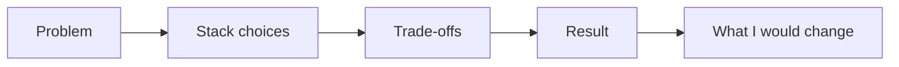

# Selected Software Projects: What I Built, Why and What Happened

*Last updated: November 3, 2026*

Selected software projects are the best proof of how an engineer thinks, because each one shows a problem, a set of choices and an outcome. Lakshay Goyal, a Software Engineer, frames his mobile and web work around those four parts, so recruiters and peers can judge decisions, not just screenshots.

**Key takeaways**

- Each project is read through four parts: problem, stack, trade-offs and result.
- Trade-offs matter more than tool names, because they show judgment.
- Mobile and web versions of the same product show range.
- Results are described honestly, with no invented metrics.
- Open items are marked [VERIFY] until the exact details are confirmed.

## What counts as a selected software project?

A selected software project is a piece of work chosen to represent an engineer's skill, not a full list of everything built. It is picked because it shows a clear problem, a reasoned technical path and a visible result. Quality of reasoning beats quantity of repositories.

Lakshay Goyal is a Software Engineer building thoughtful mobile and web products. The selected work on this site follows that idea. Each entry should answer a reader's quiet questions: what was broken, why this approach, what did it cost, and did it work?

Project lists online often work as practice exercises, school assignments or portfolio pieces [[1]](https://bestprojectideas.com/software-development-project-ideas/). That is a useful starting point. Real work adds a layer those lists skip: constraints, deadlines and teammates. The entries here keep that layer in view.

- Problem: who was hurt and what was slow, costly or confusing
- Stack: the tools chosen and the ones rejected
- Trade-offs: what was given up to ship
- Result: what changed once it was live

If you want the person behind the work first, read the [about page](/about). If you want the full picture, start from the [portfolio home](/).

## How each project is presented

Every project follows one repeatable template, so you can compare entries quickly. The template keeps the story short and puts decisions in the open. It also makes gaps obvious, which is why unconfirmed details are flagged instead of guessed.

*The five steps used to describe every selected project.* <!-- alt: Flowchart of the project template from problem to stack choices, trade-offs, result and lessons -->

The last step, what Lakshay would change, is the one most portfolios leave out. It shows that the result was reviewed honestly. It also tells a hiring manager how he handles feedback and hindsight.

### Why show the stack as a choice

Listing tools says little. Explaining why one tool beat another says a lot. A stack entry should name the need, the options considered and the reason one won. Typical areas include frontend, backend, databases, APIs and real-time communication [[1]](https://bestprojectideas.com/software-development-project-ideas/).

### Why the problem comes first

A project without a stated problem is just a demo. When the problem leads, the reader can judge every later choice against it. A heavy tool for a light problem looks wasteful. A light tool for a heavy problem looks risky. The problem is the ruler for everything else.

## Project template at a glance

The table below shows what each project entry contains and the question it answers. It works as a quick reference for recruiters scanning several projects. Fields that depend on private project details are marked for confirmation.

*Fields used to describe each selected project*

| Field | Question it answers | Status |
| --- | --- | --- |
| Problem | What needed solving, and for whom? | [VERIFY: problem statement per project] |
| Stack | Which tools were used and why? | [VERIFY: stack per project] |
| Trade-offs | What was given up to ship? | [VERIFY: trade-offs per project] |
| Result | What changed after launch? | [VERIFY: outcomes and metrics] |
| Platform | Was it web, mobile or both? | Web and mobile versions appear in the selected work |

Metrics are left out on purpose until they can be confirmed. A made-up number does more harm than a blank. Real figures will replace the placeholders as they are verified.

## Web app portfolio projects and mobile app projects

Web app portfolio projects show how an engineer handles browsers, state and deployment, while mobile app projects show how the same thinking fits small screens and device limits. Showing both for one product proves range, not just a single platform habit.

The selected work includes web and mobile views for projects named Unlovable and Exness. [VERIFY: what each product does, Lakshay's role and the stack used]. Until then, the screenshots below show how each product looks across platforms.

*Unlovable on the web. [VERIFY: feature shown]*

*Unlovable on mobile. [VERIFY: feature shown]*

### What to look for across platforms

- Does the mobile layout drop features or reorganise them
- Is navigation rethought for touch, not just shrunk
- Do both versions share the same visual language
- Is there a clear reason for any difference

These questions matter because the two platforms pull in different directions. The web rewards flexible layouts and fast iteration. Mobile rewards tight, predictable flows and care with small screens. A strong engineer can explain where each platform forced a compromise.

## Software engineer project examples: the Exness work

Software engineer project examples are most useful when the reader can see the same decision framework applied to a real product. The Exness entry in the selected work is shown in web and mobile form, so the template above can be applied to it directly.

*Exness on the web. [VERIFY: scope of Lakshay's contribution]*

*Exness on mobile. [VERIFY: scope of Lakshay's contribution]*

For this project the open questions are the problem it solved, the stack, the main trade-off and the result. [VERIFY: problem, stack, trade-off and result for the Exness project]. Once confirmed, each will be added under the matching template field.

Even before those details land, the pair of screens shows a useful habit: designing one product for two contexts. A reader can compare the two layouts and ask what was kept, what moved and what was removed. Those answers are the start of a trade-off story.

## Common trade-offs behind a stack choice

Most stack decisions come down to a handful of recurring trade-offs, and naming them is how an engineer shows judgment. The table below lists the ones that appear again and again in web and mobile work, with the question a reader should ask of each.

*Recurring trade-offs in web and mobile projects*

| Trade-off | What is gained | What is given up |
| --- | --- | --- |
| Speed to ship vs polish | A working product reaches users sooner | Edge cases and visual detail wait |
| Familiar tool vs new tool | Fewer surprises and faster progress | Possible fit gap for the problem |
| One codebase vs separate apps | Less duplicate work | Less native feel on each platform |
| Simple backend vs flexible backend | Easier to run and debug | Harder to extend later |
| Build it vs use a service | Time saved on solved problems | Less control and a new dependency |

None of these has a right answer in general. The right answer depends on the problem, the team and the deadline. That is why each project entry states its constraints first. A choice only looks good or bad once the constraint is known.

### How to read a trade-off honestly

An honest trade-off names the cost. Phrases like best tool or perfect fit hide the cost and teach the reader nothing. A better sentence says what was chosen, what was lost and why the loss was acceptable. Recruiters trust that tone because it matches how real teams talk.

## Current work and how it shapes project choices

Lakshay is currently a Software Engineer in Bangalore, India, from July 2026, after serving as a Founding Engineer from December 2025 to June 2026. His work focuses on making test automation a little less painful, moving between backend, frontend and infra.

That mix explains his project taste. He tends to favour work that crosses layers, because problems rarely stay inside one. A founding role also means owning decisions end to end, which is exactly what the trade-offs field is meant to show.

Test automation is a good lens for trade-offs. A tool that saves time but is painful to run gets abandoned. A tool that is easy to run but shallow gets ignored. Balancing those two pulls is the daily work of anyone building in that space.

For the career timeline in full, see the [about page](/about). For notes from building and deploying, browse the [blog](/blog).

> A project is only half the story. The reasoning behind its choices is the part worth reading.

## How to describe a result without inflating it

A result is the observable change after a project ships, and it can be described honestly even without a metric. State what users can now do, what got faster or simpler, and what is still unsolved. Precision about limits builds more trust than a large, unproven number.

- Say what users can do now that they could not before
- Say what got simpler for the team that maintains it
- Say what is still rough or missing
- Add a number only when it can be traced to a real source
- Link a demo or screenshots as proof

This is the standard used across the selected work. Where a figure is not confirmed, a [VERIFY] marker stands in its place. A blank that is flagged is better than a figure that cannot be defended in an interview.

## How to evaluate a software engineer's projects

To evaluate a software engineer's projects, check whether each one names a real problem, explains its choices and reports an honest result. These signals separate work that was thought through from work that was only assembled from tutorials.

1. Read the problem first and confirm it is specific.
2. Check that stack choices have reasons, not just names.
3. Look for at least one admitted trade-off.
4. Ask whether the result is measurable or at least observable.
5. Look for a demo or screenshots that prove it ran.

A short demo helps. One suggestion for portfolios is a one-to-two-minute video of the app working, embedded alongside the write-up [[1]](https://bestprojectideas.com/software-development-project-ideas/). Projects also help connect theory with practice and show skills to others [[1]](https://bestprojectideas.com/software-development-project-ideas/).

### Red flags worth noticing

- A tool list with no reasons attached
- Only success stories and no mention of cost
- Screenshots with no explanation of the problem
- Claims of impact with no way to check them

Reading habits shape engineers too. Lakshay shares ideas that stayed with him on the [bookshelf](/bookshelf), which gives extra context on how he thinks about building.

## Frequently asked questions

### What are selected software projects?

They are a curated set of software work chosen to show an engineer's skill. Each one is described by its problem, stack, trade-offs and result, so readers can judge the thinking behind the code, not just the finished screens.

### Which platforms do these projects cover?

The selected work covers both web and mobile. The Unlovable and Exness projects each appear with web and mobile views, showing how one product adapts across platforms. Details of each build are marked [VERIFY] until confirmed.

**Tags:** [software projects](/blog/tags/software-projects) · [portfolio](/blog/tags/portfolio) · [mobile apps](/blog/tags/mobile-apps) · [web apps](/blog/tags/web-apps) · [engineering](/blog/tags/engineering)

## Sources

1. [15 Software Development Project Ideas 2026-27 - Best Project Ideas](https://bestprojectideas.com/software-development-project-ideas/), published/updated 2026-02-19, accessed 2026-11-03
