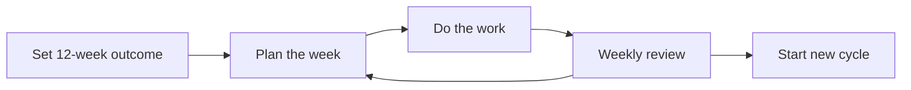

# Books for Software Engineers: The Ideas I Took From My Reading

*Last updated: November 3, 2026*

Books for software engineers do not have to be technical manuals. Lakshay Goyal's shelf is mostly non-technical: seven books on focus, freedom, courage and how to live. Below is each book, the idea he kept from it, and how that idea can shape everyday engineering work.

**Key takeaways**

- Lakshay Goyal has read seven books, all listed on his bookshelf.
- Most are non-technical: they cover focus, freedom, courage and empathy.
- The 12 Week Year is the most directly useful book for planning work.
- Technical lists add classics like Design Patterns and The Pragmatic Programmer.
- Pair one technical book with one non-technical book for balance.

## What books has Lakshay Goyal read?

Lakshay Goyal has read seven books that he keeps close: Freedom from the Known, The 12 Week Year, The Diary of a Young Girl, Krishna: The Man and His Philosophy, The Book of Man, The Book of Woman, and Why I Am an Atheist and Other Works. The full set lives on his [bookshelf](/bookshelf).

Lakshay is a Software Engineer building thoughtful mobile and web products. His bookshelf page describes the collection as ideas he keeps close: a small set of books he has read and the ideas he took from them.

*The seven books on the shelf and their authors*

| Book | Author |
| --- | --- |
| Freedom from the Known | J Krishnamurti |
| The 12 Week Year | Brian P. Moran, Michael Lennington |
| The Diary of a Young Girl | Anne Frank |
| Krishna: The Man and His Philosophy | Osho |
| The Book of Man | Osho |
| The Book of Woman | Osho |
| Why I Am an Atheist and Other Works | Bhagat Singh |

You may notice that none of these is a programming book. That is on purpose. Most lists of books for developers stop at code, architecture and interviews. This one asks a different question: what else shapes how an engineer thinks, plans and treats people?

Six of the seven books are about people, belief and living well. Only one, The 12 Week Year, is about getting work done. That mix is the angle of this article, and it is why the list can sit next to any technical reading you already do.

## What ideas did Lakshay Goyal take from these books?

Each book left one clear idea. Krishnamurti says your thoughts are second-hand, so look at life fresh. The 12 Week Year says treat every 12 weeks like a full year. Anne Frank shows hope under pressure. Bhagat Singh says to question everything, with logic and no ego.

*One idea per book, and where it can help an engineer*

| Book | Idea kept | Where it helps in engineering |
| --- | --- | --- |
| Freedom from the Known | Drop conditioning and look at life fresh | Questioning inherited code and habits |
| The 12 Week Year | Treat every 12 weeks like a full year | Planning in short cycles |
| The Diary of a Young Girl | Believe people are good at heart, even under pressure | Keeping perspective on bad days |
| Krishna: The Man and His Philosophy | Stay calm while living fully | Staying steady during hard releases |
| The Book of Man | Zorba the Buddha: enjoy life and stay aware | Balancing drive with awareness |
| The Book of Woman | Love that tries to own someone is not love | Working with people without control |
| Why I Am an Atheist and Other Works | Question everything | Honest design and code review |

The right-hand column is my reading of how each idea carries into software work. The middle column is what Lakshay took from the book. The next sections go through them one at a time, and each gives a small, practical way to use the idea.

*A suggested reading order: start with the practical book, then move to the reflective ones.*

If you only have time for two, start with The 12 Week Year for planning and Freedom from the Known for thinking. Together they cover how you decide what to build and how you decide how to build it.

## Freedom from the Known: question what you inherited

Freedom from the Known, by J Krishnamurti, argues that your thoughts are second-hand and that you can drop the conditioning and look at life fresh. Lakshay says it messed with his head in a good way. For engineers, it is a book about assumptions.

Every codebase carries inherited decisions. A folder structure, a naming rule or a framework choice was once a fresh decision by someone else. Over time it becomes just how things are done. The book pushes you to ask whether the reason still holds.

### How to use the idea in a project

- Before copying a pattern, ask what problem it solved
- Write down the assumption behind a design before you defend it
- Read old code as if you had never seen the team's rules
- Ask a newcomer which parts of the setup look odd to them

None of this means ignoring good practice. It means knowing why you follow it. When you can state the reason, you can also tell when the reason has gone away.

### A small example

Say a team always builds a new service for every feature. Fresh eyes might ask whether a module inside the existing app would do. The answer may still be a new service. But the question is now a choice, not a habit, and that is the whole point of the book.

## The 12 Week Year: plan in short cycles

The 12 Week Year, by Brian P. Moran and Michael Lennington, says to forget yearly goals and treat every 12 weeks like a full year. Lakshay calls it simple, and says it works against procrastination. It is the most directly practical book on his shelf.

A year is long enough to hide drift. You can lose a quarter and still feel on track. A 12-week window feels closer, so each week matters more. For engineers, this fits well with how product work already runs in cycles.

### A simple 12-week loop

1. Pick one outcome for the next 12 weeks
2. Break it into goals for each week
3. Review progress at the end of every week
4. Adjust the plan based on what you learned
5. Start the next 12-week cycle with a fresh outcome

*The 12-week loop: plan, work, review, repeat.* <!-- alt: Flowchart of a repeating 12-week planning cycle with a weekly review step -->

The weekly review is the part that makes it work. Without it, a plan is only a wish. With it, you notice slipping goals while there is still time to fix them.

### Where it fits engineering work

Use it for learning goals, side projects or a large feature. Pick a clear outcome, such as shipping one working piece, then slice it into weekly tasks. If a week goes badly, you have eleven more weeks to adjust. That is easier to face than a missed yearly goal.

## The Diary of a Young Girl, Krishna and Osho: staying steady

These four books are about staying steady and human under pressure. They give an engineer perspective more than technique. Each one gives a different answer to the same question: how do you keep your balance when things get hard?

### The Diary of a Young Girl: keep perspective

Anne Frank's diary follows a 13-year-old hiding from the Nazis for two years, still believing people are good at heart. Lakshay says it makes his bad days look silly. A failed deploy or a rough review is real, but this book resets the scale.

### Krishna: The Man and His Philosophy: calm in the middle of it

Osho presents Krishna as a man who danced, loved, fought and stayed calm through all of it. The lesson Lakshay took is that you do not need to run to the Himalayas to be spiritual. You can stay steady inside a busy life.

For engineers, that reads as on-call calm. You can care about the outcome and still keep a level head while debugging an incident.

### The Book of Man: Zorba the Buddha

Osho looks at every role men get pushed into. The big takeaway is Zorba the Buddha: enjoy life fully and stay aware, with no need to pick one. In work terms, you can be driven and still be reflective. Ambition and awareness do not cancel each other.

### The Book of Woman: love without ownership

This book is about love, freedom and the feminine side in all of us. Its sharpest point is that love that tries to own someone is not love. Lakshay says some takes you will love and some you will argue with. That is a fair way to read it.

Teams show this idea too. Good collaboration gives people room to own their work instead of controlling it.

## Why I Am an Atheist and Other Works: question everything

Why I Am an Atheist and Other Works collects writing by Bhagat Singh. It shows a 23-year-old in jail, waiting to be hanged, calmly explaining why he does not believe in God. Lakshay describes it as zero ego and all logic, and the lesson is to question everything.

Engineers already value evidence. This book adds a standard for how to disagree: with reasons, calmly, and without making it personal. That is a useful bar for a design discussion.

> Question everything, but do it with logic and without ego. That is a good rule for code review and for design.

### Ways to apply it

- Ask for the reason behind a requirement before building it
- Disagree in review with evidence, not tone
- Be ready to change your mind when the data says so
- Say what you do not know instead of guessing

Pair this with Freedom from the Known. One tells you to look past inherited assumptions. The other shows how to challenge them calmly and clearly.

## How do these compare with the usual technical lists?

Technical lists lean on classics. One list names Designing Data-Intensive Applications by Martin Kleppmann as its must-read, then A Philosophy of Software Design and The Pragmatic Programmer 20th Anniversary [[1]](https://stackpicks.dev/blog/best-books-for-software-engineers-2026). These teach craft. The books above teach judgment, focus and temperament.

*Technical picks from other ranking lists*

| Book | Why lists pick it |
| --- | --- |
| Designing Data-Intensive Applications | Its ideas on replication, partitioning and transactions still map to modern systems [[1]](https://stackpicks.dev/blog/best-books-for-software-engineers-2026) |
| Design Patterns | It explains 23 reusable approaches to recurring object-oriented design problems [[2]](https://www.guru99.com/software-engineer-book.html) |
| The Pragmatic Programmer | Its advice is broad and general, and it covers concurrency, security and testing [[2]](https://www.guru99.com/software-engineer-book.html) |
| Don't Make Me Think | A usability resource, now in its third edition with a mobile chapter [[3]](https://hackr.io/blog/software-engineering-books) |
| Cracking the Coding Interview | It offers 189 interview questions for practice [[3]](https://hackr.io/blog/software-engineering-books) |
| Code Complete | A long reference whose reasoning carries across most programming environments [[2]](https://www.guru99.com/software-engineer-book.html) |

These books are well loved for good reason. Lists like this are a fair place to start if you want to build skill in system design, patterns or interviews.

### Why add non-technical books

Technical books tell you how to build. They rarely tell you how to decide what is worth building, how to stay steady under pressure, or how to disagree well. The books on Lakshay's shelf fill that gap, so they add to the technical classics instead of replacing them.

### A reading order that mixes both

1. Start with a practical technical book such as The Pragmatic Programmer
2. Add The 12 Week Year to plan your reading and your work
3. Read Freedom from the Known to question your habits
4. Move on to a deeper technical book like Designing Data-Intensive Applications
5. Finish with a reflective title such as Why I Am an Atheist and Other Works

One list suggests early-career engineers begin with The Pragmatic Programmer and later move to Designing Data-Intensive Applications at mid-level [[1]](https://stackpicks.dev/blog/best-books-for-software-engineers-2026)[[1]](https://stackpicks.dev/blog/best-books-for-software-engineers-2026). Slot a non-technical book between each step to keep the reading balanced.

## Where to go next

Books for software engineers work best when you pick a few and actually apply them. Start with the [full bookshelf](/bookshelf) to see each book with the idea Lakshay took from it, then choose one to read this month.

For more notes from building and deploying software, browse the [blog](/blog). To see the work behind the reading, visit the [about page](/about) and learn what keeps Lakshay curious.

If you want to talk about books, products or engineering, the contact link on the site lets you book a 30-minute chat.

## Frequently asked questions

### Are non-technical books worth reading for engineers?

Yes. Lakshay Goyal's shelf is mostly non-technical, and the ideas on focus, planning and questioning assumptions apply to daily engineering work. Pair them with a technical classic for balance.

### Which book is best for planning work?

The 12 Week Year. Lakshay says its idea of treating every 12 weeks like a full year stops procrastination. It is simple, and it works.

### Which book helps most with questioning assumptions?

Freedom from the Known by J Krishnamurti. It argues that your thoughts are second-hand and asks you to look at life fresh, which helps when you review inherited code or habits.

**Tags:** [reading list](/blog/tags/reading-list) · [software engineering](/blog/tags/software-engineering) · [books](/blog/tags/books) · [developer growth](/blog/tags/developer-growth) · [non-technical books](/blog/tags/non-technical-books)

## Sources

1. [Best Books for Software Engineers to Read in 2026 — StackPicks — StackPicks](https://stackpicks.dev/blog/best-books-for-software-engineers-2026), published/updated 2026-09-09, accessed 2026-11-03
2. [10 BEST Software Engineering Books (2026 Update)](https://www.guru99.com/software-engineer-book.html), published/updated 2026-10-28, accessed 2026-11-03
3. [10 Best Software Engineering Books to Read in 2026](https://hackr.io/blog/software-engineering-books), published/updated 2025-01-30, accessed 2026-11-03
